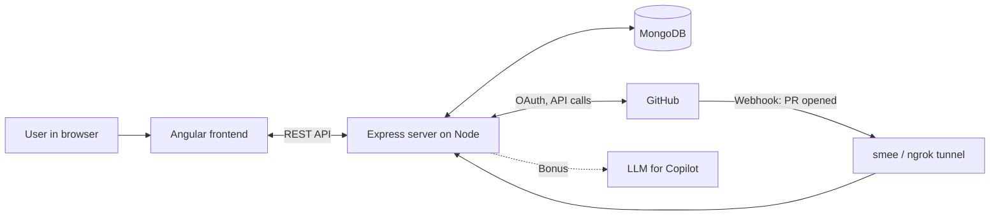
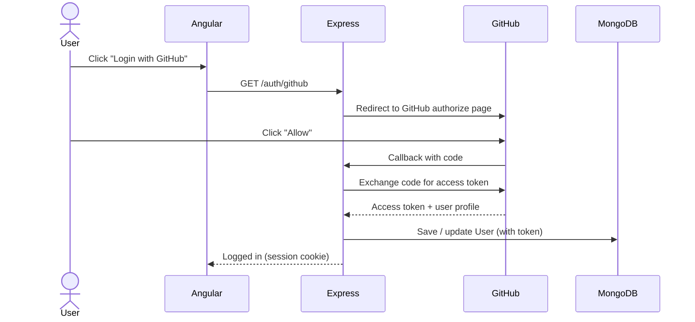
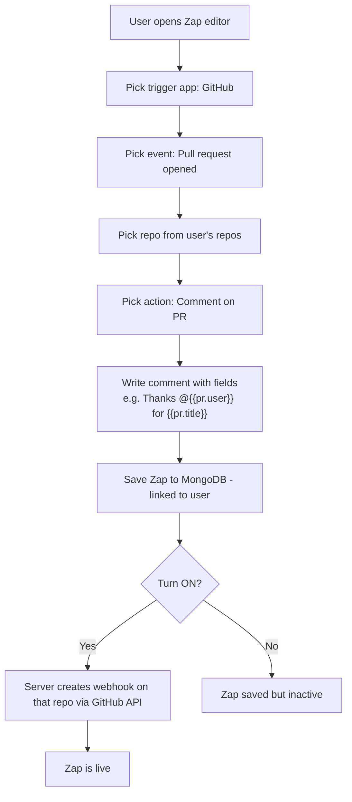
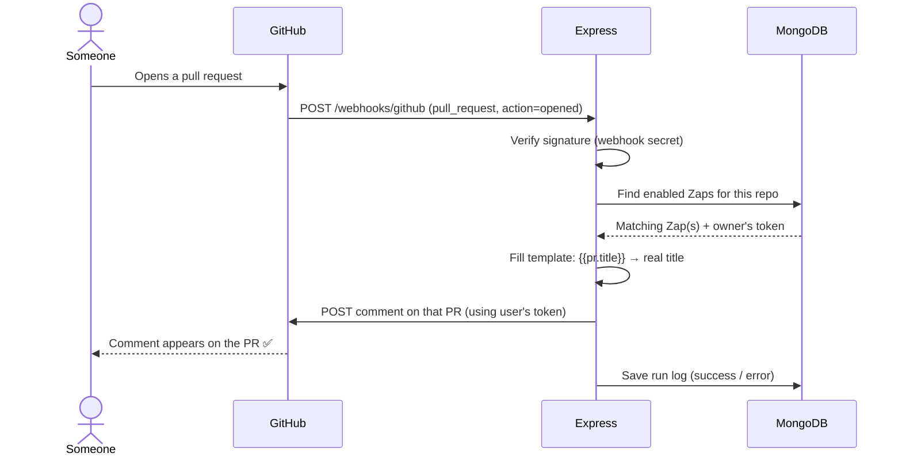
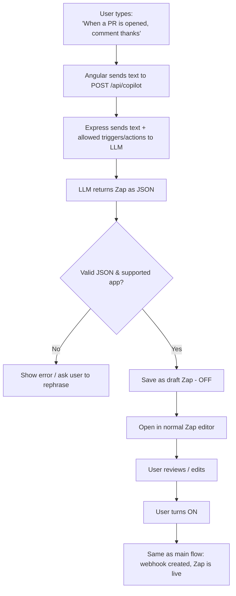

# Zap Automation – Take-Home Project

## What we are building (simple words)
A small website where a user logs in with GitHub and creates a **rule** (a "Zap"):
**"When a pull request is opened on my repo → post a comment on it."**
When someone opens a real PR, our app automatically posts the comment.

- Inspired by Zapier, but tiny: one trigger + one action.
- Time box: **4 hours** (write start/stop time in README).
- Started: ____  Stopped: ____

## How Claude must work on this project
Follow these at all times (auto-loaded):
- @docs/ENGINEERING_GUIDELINES.md — architecture, FP, routing, MongoDB, security, testing, milestone report format
- @docs/UI_AND_NODE_GUIDELINES.md — Angular UI craft, design system, Node/Express quality bar
- Record significant decisions in `docs/DECISIONS.md`.

## Tech stack (required)
| Part | Tool | Job |
|---|---|---|
| Frontend | **Angular** (TypeScript) | The screens: login, Zap list, Zap editor, Copilot box |
| Backend | **Express on Node.js** (TypeScript) | Login, APIs, receiving GitHub webhooks, posting comments |
| Database | **MongoDB** (Mongoose) | Stores users, Zaps, run history |
| External | **GitHub** | OAuth login, webhooks, comments API |
| Dev tunnel | **smee.io / ngrok** | Lets GitHub reach our local server |

## Requirements checklist
### Must have
- [ ] Sign in with GitHub (OAuth)
- [ ] Zaps belong to the signed-in user
- [ ] List / create / edit a Zap: name, on/off, trigger, action, field mapping
- [ ] App picker with several dev tools (only GitHub works; others "coming soon")
- [ ] Real PR opened → comment appears on that PR
- [ ] Runnable repo + README for a teammate
- [ ] Real git habits: branches, small commits, PRs

### Bonus
- [ ] Copilot: plain English → draft Zap (OFF) → user reviews → turns ON

---

## Diagram 1 – Big picture (how the pieces connect)

## Diagram 2 – Main flow (MUST HAVE)

### 2a. Login with GitHub

### 2b. Create and turn on a Zap

### 2c. PR opened → comment posted (the end-to-end magic)

## Diagram 3 – Optional flow (BONUS: Copilot)

---

## Data we store
- **User**: githubId, login, avatarUrl, accessToken
- **Zap**: userId, name, enabled, trigger {app, event, repo}, action {app, type, commentTemplate}, webhookId
- **ZapRun**: zapId, status, error, createdAt

## Build order (one branch + PR each)
1. `chore/scaffold` – Angular + Express + Mongo setup
2. `feat/github-auth` – login
3. `feat/zap-crud` – list/create/edit + app picker
4. `feat/webhook-engine` – webhook + post comment
5. `docs/readme` – setup steps, env vars, start/stop time
6. `feat/copilot` – bonus, only if time left

## How we test it
1. Start MongoDB, server, client, and tunnel
2. Log in with GitHub
3. Create a Zap on a test repo, turn it ON
4. Open a PR on that repo → comment appears
5. Turn Zap OFF → open another PR → no comment
